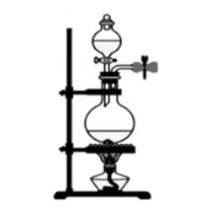
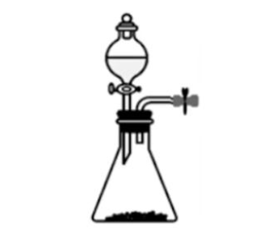
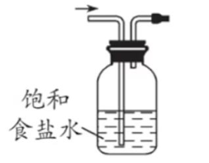
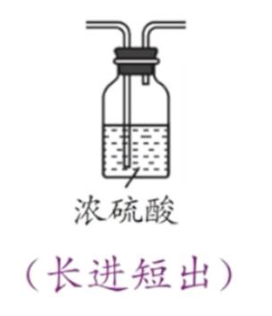
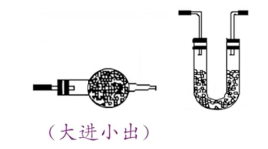
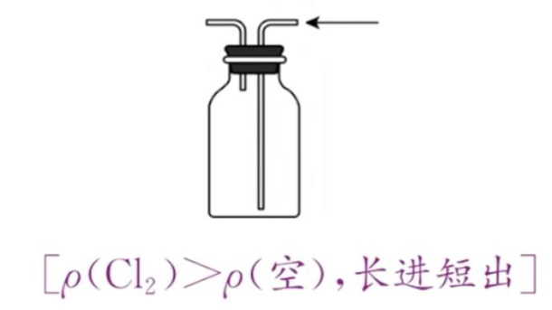
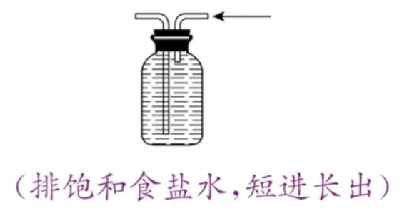
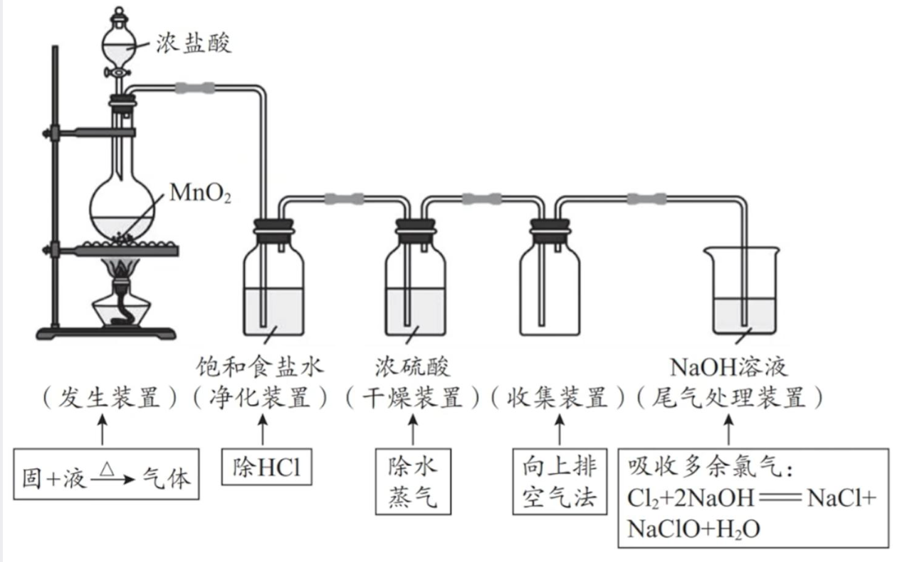

## [2-4]氯气实验室制备+次氯酸

### 氯气的实验室制备

#### 1. 原理 (遵循氧化还原反应的“由强制弱”规律)

化学方程式：$MnO_2 + 4 HCl(\text{浓}) \overset{\Delta}{=} MnCl_2 + Cl_2 \uparrow + 2 H_2O$

离子方程式：$MnO_2 + 4 H^+ + 2 Cl^- \overset{\Delta}{=} Mn^{2+} + Cl_2 \uparrow + 2 H_2O$

注：(1) 由于 $MnO_2$ 的氧化性不是特别强，所以需要使用浓盐酸并加热。

(2) 该反应是部分氧化还原反应，4份 $HCl$ 中，2份体现还原性(化合价升高)，2份体现酸性(化合价不变，生成盐)。氧化剂($MnO_2$)与还原剂($HCl$)的个数比为1:2。

(3) 若将 $MnO_2$ 换成更强的氧化剂，则使用的盐酸浓度可以降低，且不需要加热。

如用 $KMnO_4$ 制备 $Cl_2$ 的化学方程式为 $2 KMnO_4 + 16 HCl = 2 MnCl_2 + 2 KCl + 5 Cl_2 \uparrow + 8 H_2O$，

离子方程式为 $2 MnO_4^- + 16 H^+ + 10 Cl^- = 2 Mn^{2+} + 5 Cl_2 \uparrow + 8 H_2O$。

#### 2. 发生装置(反应物的状态以及反应条件决定了发生装置使用的仪器)

<table>
 <tr>
 <td>
 $MnO_2 + 4HCl(\text{浓}) \overset{\triangle}{=}$ 
 $MnCl_2 + Cl_2 \uparrow + 2H_2O$
 </td>
 <td>
 $2KMnO_4 + 16HCl = $ 
 $2MnCl_2 + 2KCl + 5Cl_2 \uparrow + 8H_2O$
 </td>
 </tr>
 <tr>
 <td></td>
 <td></td>
 </tr>
</table>

注：(1) 用 $MnO_2$ 制备$Cl_2$，一定不要漏掉“酒精灯”。 (2) 这两个装置均可用“液差法”检查气密性。

#### 3. 除杂装置

<table>
 <tr><td>杂质</td><td>$\text{H}\text{Cl}$ 气体</td></tr>
 <tr><td>产生杂质的原因</td><td>盐酸具有挥发性</td></tr>
 <tr><td>杂质性质</td><td>$\text{H}\text{Cl}$ 气体极易溶于水、强酸性</td></tr>
 <tr><td>目标气体性质</td><td>$\text{Cl}_2$ 可溶于水、水溶液显酸性、强氧化性</td></tr>
 <tr><td>除杂原理</td><td>利用饱和食盐水中的水溶解 $\text{H}\text{Cl}$ 气体，同时利用 $\text{Na}\text{Cl}$ 抑制 $\text{Cl}_2$ 的溶解</td></tr>
 <tr><td>除杂试剂</td><td>饱和食盐水</td></tr>
 <tr><td>除杂装置 (长进短出)</td><td></td></tr>
</table>

#### 4. 干燥装置

<table>
 <tr>
 <td colspan="3">$\text{Cl}_2$ 水溶液显酸性，不能用碱性干燥剂(如碱石灰)干燥</td>
 </tr>
 <tr>
 <td>干燥剂</td>
 <td>浓硫酸(液态)</td>
 <td>$\text{P}_2\text{O}_5$ 或无水 $\text{CaCl}_2$ (固态)</td>
 </tr>
 <tr>
 <td>装置</td>
 <td></td>
 <td></td>
 </tr>
</table>

注：(1)U形干燥管只能装固体干燥剂，若装液体干燥剂，会被生成的气体压入后续装置中。
(2)若水蒸气对后续实验无干扰，则无需干燥气体。
(3)验证氯气没有漂白性，氯气必须干燥，且有色物质也必须干燥。
(4)一般情况下，先除去其他杂质气体，后除水蒸气。

#### 5. 收集装置
常见的收集方法有排空气法和排液法。排空气法又有敞开体系的排空气法和密闭体系的排空气法。$\text{Cl}_2$ 是有毒气体，应该用密闭体系的排空气法，便于进行尾气处理。若用排液法收集气体，则所选液体不能溶解目标气体。

<table>
 <tr>
 <td>方法</td>
 <td>密闭体系的排空气法</td>
 <td>排液法</td>
 </tr>
 <tr>
 <td>装置</td>
 <td></td>
 <td></td>
 </tr>
</table>

#### 6. 尾气处理装置

若气体有毒或易燃易爆，则需要尾气处理。尾气处理主要解决两个问题：

一是用什么试剂吸收尾气；二是用什么仪器吸收尾气。

<table>
 <thead>
 <tr>
 <td>$\text{Cl}_2$的性质</td>
 <td>吸收剂</td>
 <td>装置</td>
 </tr>
 </thead>
 <tbody>
 <tr>
 <td>水溶液显酸性、强氧化性</td>
 <td>碱性溶液(NaOH溶液或石灰乳等); 还原性溶液$(\text{Fe}\text{Cl}_2$,$\text{Na}_2\text{S}$等)</td>
 <td></td>
 </tr>
 </tbody>
</table>

#### 7. 舍勒法实验室制备干燥纯净$\text{Cl}_2$的装置图

注：实验目的改变，装置图也会做相应改变。如制备并验证氯气的氧化性，可往收集装置中加入淀粉$\text{K}\text{I}$溶液，且净化装置可以省略。

### 次氯酸(HClO)的性质
#### 1. 从组成上
$\text{H}\text{Cl}\text{O}$具有酸性，且为一元弱酸。
$\text{H}\text{Cl}\text{O}$的酸性比$\text{H}_2\text{CO}_3$还弱，所以漂白粉和漂白液若敞开放置在空气中，会与空气中的$\text{CO}_2$发生反应而变质。
#### 2. 从化合价上
$\text{H}\text{Cl}\text{O}$具有强氧化性、漂白性
Cl元素的稳价为-1价，$\text{H}\text{Cl}\text{O}$中Cl为+1价，其化合价极易降低为-1价，得到电子，体现强氧化性。其强氧化性可以将大多数的有机色素氧化，使有机色素褪色，因此$\text{H}\text{Cl}\text{O}$又有漂白性。$\text{H}\text{Cl}\text{O}$因具有强氧化性，还可用于杀菌消毒。

注：要证明$\text{Cl}_2$无漂白性，而$\text{H}\text{Cl}\text{O}$才有漂白性，一般是将干燥氯气分别通入装有干燥有色布条、湿润有色布条的集气瓶中。干燥有色布条不褪色，湿润有色布条褪色。
#### 3. $\text{H}\text{Cl}\text{O}$还具有不稳定性

光照新制氯水后，氯水的pH减小，且$\text{Cl}^-$、$\text{O}_2$浓度都增大，说明光照条件下$\text{H}\text{Cl}\text{O}$会分解产生$\text{H}\text{Cl}$和$\text{O}_2$，对应化学方程式为$2\text{H}\text{Cl}\text{O}\text{=} \text{H}\text{Cl}+\text{O}_2\uparrow$。加热条件也会使$\text{H}\text{Cl}\text{O}$分解。用棕色瓶保存氯水，就是避免其见光分解。

