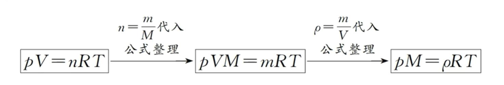

## [3-3]理想气体状态方程+阿伏加德罗定律

#### 1. 理想气体状态方程

##### (1) 研究对象
理想气体

##### (2) 公式
$pV=nRT$

<table><tdead><tr><td>符号</td><td>p</td><td>V</td><td>n</td><td>R</td><td>T</td></tr></tdead><tbody><tr><td>物理量</td><td>压强</td><td>气体(容器)体积</td><td>气体物质的量</td><td>常数</td><td>温度</td></tr></tbody></table>

#### 2. 理想气体状态方程的衍生公式以及结论

##### (1) 衍生公式推导过程

<table>
 <tdead>
 <tr>
 <td>符号</td>
 <td>p</td>
 <td>V</td>
 <td>R</td>
 <td>T</td>
 <td>$\rho$</td>
 <td>n</td>
 <td>m</td>
 <td>M</td>
 </tr>
 </tdead>
 <tbody>
 <tr>
 <td>物理量</td>
 <td>压强</td>
 <td>气体(容器)体积</td>
 <td>常数</td>
 <td>温度</td>
 <td>密度</td>
 <td>气体物质的量</td>
 <td>质量</td>
 <td>摩尔质量</td>
 </tr>
 </tbody>
</table>

##### (2) 公式及其运用

根据条件，消掉相同变量与常数 R，确定剩余变量之间的关系。
①同温、同压下，气体体积与气体物质的量成正比 ($\not p V=n\not R\not T \to V \propto n$)。

②同温、同体积下，气体压强与气体物质的量成正比 ($p\not V=n\not R\not T \to p \propto n$)。

③同温、同压下，同体积的任何气体，其分子物质的量相同 ($\not pV=n\not R\not T \to V \propto n \to V$ 相同则 $n$ 相同)。

④同温、同压下，同体积的任何气体，其分子个数相同（此即为阿伏加德罗定律）。
($pV=nRT, 且 n=\frac{m}{M} \to \not p\not VM=N\not R\not T \to V \propto N, V$ 相同，则 $N$ 相同)

⑤同温、同压、同体积下，气体摩尔质量与气体质量成正比 
($pV=nRT, 且 n=\frac{N}{N_A} \to \not p\not VN_A=m\not R\not T \to M \propto m$)。

⑥同温、同压下，气体摩尔质量与气体密度成正比：
$pVM=mRT, 且 \rho=\frac{m}{V} \rightarrow \not pM=\rho \not R\not T \to M \propto \rho)$。
i.空气平均摩尔质量约为28.8 g/mol，在同温、同压下，若气体$M>28.8$g/mol，该气体密度大于空气；反之，若气体$M<28.8$g/mol，该气体密度小于空气。
ii.同温、同压下，已知某气体A对$H_2$的相对密度是22，可求气体A的摩尔质量。
由于同温、同压下，$\frac{M_A}{M_{H_2}}=\frac{\rho_A}{\rho_{H_2}} (\rho_A$即A对$H_2$的相对密度)，
则气体A的摩尔质量=$H_2$的摩尔质量×相对密度=2 g/mol×22=44 g/mol。

注：以上的理想气体状态方程及其推论和定律(衍生公式)是解决复杂计算题的基石，请同学们尝试用基础公式推导衍生公式，并理解衍生公式。这和我们学习数学和物理是相似的，学习数学和物理时，我们也要学会用教材上的基础公式去推导一些二级结论(或衍生公式)，利用这些二级结论解决一些特定的选择题或填空题会极为高效。