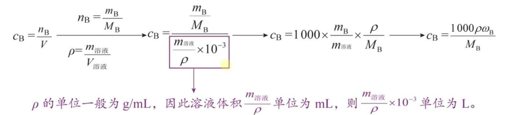
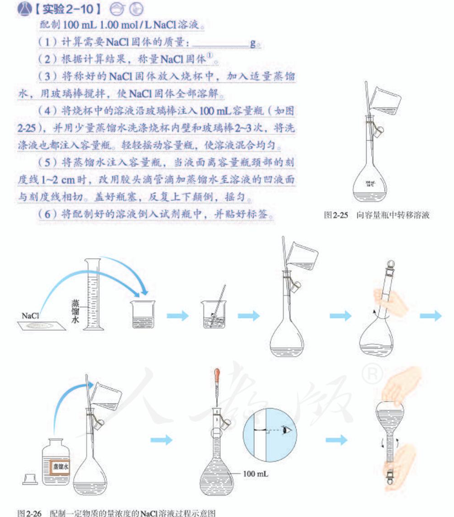

## [3-4]物质的量浓度

#### 1.溶质的质量分数

<table>
 <tdead>
 <tr>
 <td>定义</td>
 <td>表示单位质量的溶液里所含溶质B的质量</td>
 </tr>
 <tr>
 <td>对象</td>
 <td>混合气体或溶液</td>
 </tr>
 <tr>
 <td>符号</td>
 <td>ω$_\text{B}$</td>
 </tr>
 <tr>
 <td>单位</td>
 <td>1</td>
 </tr>
 <tr>
 <td>公式</td>
 <td>ω$_\text{B} = \frac{m_B}{m_{溶液}} × $100%</td>
 </tr>
 <tr>
 <td>规律</td>
 <td>溶液一旦配制好, ω$_\text{B}$ 就为定值, 与所取用的溶液体积、质量均无关系</td>
 </tr>
 <tr>
 <td>缺点</td>
 <td>溶液和气体均为流体, 测量体积比测量质量更方便</td>
 </tr>
 </tdead>
</table>

注:溶液中的溶质往往不单一,一定要指明研究对象。

#### 2. 物质的量浓度

<table><tdead><tr><td>定义</td><td>表示单位体积的溶液里所含溶质 B 的物质的量</td></tr></tdead><tbody><tr><td>对象</td><td>混合气体或溶液</td></tr><tr><td>符号</td><td>$c_B$</td></tr><tr><td>单位</td><td>常用单位是“$mol\cdot L^{-1}$”或“mol/L”</td></tr><tr><td>公式</td><td>$c_B = \frac{n_B}{V}$</td></tr><tr><td>规律</td><td>溶液一旦配制好，浓度就为定值，与所取用的溶液体积无关。</td></tr></tbody></table>

注：(1)公式中的 V 是溶液体积，不是溶剂(水)的体积。
(2)溶液中溶质往往不单一，一定要指明浓度的研究对象。
(3)溶液稀释公式：$n_{B浓} = n_{B稀} \rightarrow c_{B浓} V_{浓} = c_{B稀} V_{稀}$

#### 3. 质量分数与物质的量浓度的关系

(ρ、ωB、MB分别表示溶液密度、溶质B的质量分数、溶质B的摩尔质量，且ρ的单位是g/mL)

注：同学们要尝试自己推导一些衍生公式，并理解公式的意义和运用范围；物理和数学中也有很多衍生公式，请同学们将这些学科中的衍生公式也进行推导和理解。

#### 4. 实验室配制一定物质的量浓度的溶液

注：①写实验器材名时，容量瓶必须带上完整的规格，如100 mL容量瓶。
②常见容量瓶的规格为100mL，250mL，500mL和1000mL。
③配制如$H_2SO_4$等溶于水会放热的溶液时，需在烧杯中冷却后再转移到容量瓶中，防止容量瓶受热变形。