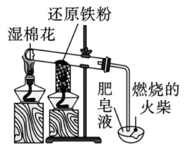

## [4-1]铁单质+铁的氧化物

### 铁单质

#### 1. 自然界存在
铁元素在自然界中几乎都以化合物的形式存在（但铁在自然界中可以像陨铁中的铁那样以单质形态存在）。铁元素在地壳中的含量居第四位，前三位的元素依次是氧、硅、铝。

#### 2. 人体中的铁元素
铁元素是人体必需微量元素中含量最多的一种，功能性铁元素主要参与氧的运输。为了减少缺铁性贫血，可以食用铁强化酱油。

#### 3. 铁的化合价
铁的常见化合价有0、+2、+3，用于净水的 $\text{K}_2\text{Fe}\text{O}_4$（高铁酸钾）中，铁元素的化合价为+6。

#### 4. 物理性质
在常温下，纯净的铁块为银白色（铁的合金以及铁粉一般为黑色）具有金属光泽的固体，能导电和导热，具有延展性和磁性。

#### 5. 化学性质

根据金属活动性顺序表可知，铁单质具有较强的还原性，能与很多氧化剂反应。

##### (1) 与非金属单质的反应
①与 $\text{O}_2$ 反应

i.常温下暴露在空气中的生铁容易发生吸氧腐蚀，铁锈的主要成分为 $\text{Fe}_2\text{O}_3\cdot x\text{H}_2\text{O}$（常温下，潮湿环境利于铁的腐蚀，所以减少铁的腐蚀措施之一是保持其干燥）。
ii.在纯氧中点燃：$3\text{Fe}+2\text{O}_2 \overset{\text{点燃}}{=} \text{Fe}_3\text{O}_4$

注：这两个反应体现了温度的“量变引起质变”。

②与 $\text{Cl}_2$ 反应：$2\text{Fe} + 3\text{Cl}_2 \overset{\Delta}{=} 2\text{FeCl}_3$

注：强氧化性的 $\text{Cl}_2$ 与 $\text{Fe}$ 反应只能生成 +3 价的铁盐，无量变引起质变。

③与 $\text{S}$ 反应：$\text{Fe} + \text{S} \overset{\Delta}{=} \text{FeS}$

注：$\text{S}$ 的氧化性较弱，铁与 $\text{S}$ 反应只能生成 +2 价的亚铁盐，无量变引起质变。

##### (2) 与化合物的反应

<table>
<thead>
</thead>
<tbody>
<tr>
<td>与水蒸气</td>
<td>$3\text{Fe}+4\text{H}_2\text{O(g)} \overset{\text{高温}}{=} \text{Fe}_3\text{O}_4+4\text{H}_2$</td>
</tr>
<tr>
<td>与酸</td>
<td>盐酸或稀硫酸：$\text{Fe}+2\text{H}^+ = \text{Fe}^{2+}+\text{H}_2\uparrow$ （$\text{Fe}$ 与非氧化性酸，如稀硫酸、盐酸等反应，不管酸量多，还是酸量少，只能生成亚铁盐）</td>
</tr>
<tr>
<td>与盐</td>
<td>$\text{Fe}+2\text{Fe}^{3+} = 3\text{Fe}^{2+}$；$\text{Fe}+\text{Cu}^{2+} = \text{Cu}+\text{Fe}^{2+}$（湿法冶铜）</td>
</tr>
</tbody>
</table>

注：铁和 $\text{Cl}_2$、$\text{O}_2$ 反应需要一定的引发条件，要么需要水的存在，要么需要一定的温度。常温下，铁和干燥的 $\text{Cl}_2$、$\text{O}_2$ 均不反应，所以液氯、液氧可以保存在钢瓶中。

#### 6. 重点实验——铁与水蒸气反应的实验

##### (1) 原理
$3\text{Fe} + 4\text{H}_2\text{O(g)} \overset{\text{高温}}{=} \text{Fe}_3\text{O}_4 + 4\text{H}_2$

##### (2) 装置图

注：①湿棉花用于提供水蒸气。②还原性铁粉下的酒精灯可用酒精喷灯替换。③肥皂液用于收集氢气。

##### (3) 现象
用火柴点燃肥皂泡，听到爆鸣声。

##### (4) 结论
铁与水蒸气反应，生成可燃性气体 $\text{H}_2$。

#### 7.用途
(1) 铁的合金是良好的建筑材料；
(2) 用于其他金属的冶炼。

#### 8.冶炼——高炉炼铁（热还原法）
$\text{Fe}_2\text{O}_3 + 3\text{CO} \overset{\text{高温}}{=} 2\text{Fe} + 3\text{CO}_2$

注：原料可以是赤铁矿(主要成分是 $\text{Fe}_2\text{O}_3$)，也可以是磁铁矿(主要成分是 $\text{Fe}_3\text{O}_4$)。

### 铁的氧化物

<table>
<thead>
<tr>
<th>物质</th>
<th>氧化亚铁($\text{FeO}$)</th>
<th>氧化铁($\text{Fe}_2\text{O}_3$)</th>
<th>四氧化三铁($\text{Fe}_3\text{O}_4$)</th>
</tr>
</thead>
<tbody>
<tr>
<td>类别</td>
<td>碱性氧化物</td>
<td>碱性氧化物</td>
<td>——</td>
</tr>
<tr>
<td>俗名</td>
<td>——</td>
<td>铁红</td>
<td>磁性氧化铁</td>
</tr>
<tr>
<td>色、态</td>
<td>黑色粉末</td>
<td>红棕色粉末</td>
<td>黑色晶体</td>
</tr>
<tr>
<td>溶解度(水)</td>
<td>难溶</td>
<td>难溶</td>
<td>难溶</td>
</tr>
<tr>
<td>$\text{Fe}$ 的化合价</td>
<td>$+2$</td>
<td>$+3$</td>
<td>$+2$、$+3$</td>
</tr>
<tr>
<td>与 $\text{CO}$ 反应</td>
<td>$\text{FeO} + \text{CO} \overset{\text{高温}}{=} \text{Fe} + \text{CO}_2$</td>
<td>$\text{Fe}_2\text{O}_3 + 3\text{CO} \overset{\text{高温}}{=} 2\text{Fe} + 3\text{CO}_2$</td>
<td>$\text{Fe}_3\text{O}_4 + 4\text{CO} \overset{\text{高温}}{=} 3\text{Fe} + 4\text{CO}_2$</td>
</tr>
<tr>
<td>与盐酸或 稀硫酸反应</td>
<td>$\text{FeO} + 2\text{H}^+ = \text{Fe}^{2+} + \text{H}_2\text{O}$</td>
<td>$\text{Fe}_2\text{O}_3 + 6\text{H}^+ = 2\text{Fe}^{3+} + 3\text{H}_2\text{O}$</td>
<td>$\text{Fe}_3\text{O}_4 + 8\text{H}^+ = \text{Fe}^{2+} + 2\text{Fe}^{3+} + 4\text{H}_2\text{O}$</td>
</tr>
<tr>
<td>用途</td>
<td>冶炼铁</td>
<td>冶炼铁、颜料</td>
<td>冶炼铁、磁铁</td>
</tr>
</tbody>
</table>

注：$\text{FeO}$ 不稳定，在空气中受热，能迅速被氧化成 $\text{Fe}_3\text{O}_4$，对应化学方程式为 $6\text{FeO} + \text{O}_2 \overset{\Delta}{=} 2\text{Fe}_3\text{O}_4$。