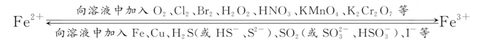
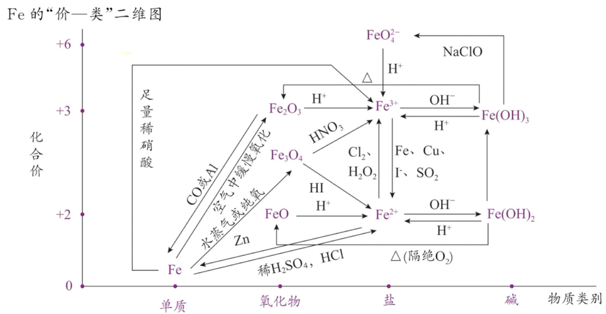

## [4-2]铁的氢氧化物+铁盐与亚铁盐+铁及其化合物的转化关系

### 铁的氢氧化物(碱)
#### 1. 组成和性质对比
<table>
<thead>
<tr>
<th>化学式</th>
<th>$\text{Fe}(\text{OH})_2$</th>
<th>$\text{Fe}(\text{OH})_3$</th>
</tr>
</thead>
<tbody>
<tr>
<td>色、态</td>
<td>白色固体</td>
<td>红褐色固体</td>
</tr>
<tr>
<td>溶解度(水)</td>
<td>难溶</td>
<td>难溶，溶解度比 $\text{Fe}(\text{OH})_2$ 更小</td>
</tr>
<tr>
<td>化合价</td>
<td>+2</td>
<td>+3</td>
</tr>
<tr>
<td>化性</td>
<td>碱性、强还原性、受热不稳定性</td>
<td>碱性、受热不稳定性</td>
</tr>
<tr>
<td>与盐酸或稀硫酸反应</td>
<td>$\text{Fe}(\text{OH})_2 + 2\text{H}^+ = \text{Fe}^{2+} + 2\text{H}_2\text{O}$</td>
<td>$\text{Fe}(\text{OH})_3 + 3\text{H}^+ = \text{Fe}^{3+} + 3\text{H}_2\text{O}$</td>
</tr>
<tr>
<td>加热</td>
<td>隔绝空气加热：$\text{Fe}(\text{OH})_2 \overset{\Delta}{=} \text{Fe}\text{O} + \text{H}_2\text{O}$ 空气中加热：$4\text{Fe}(\text{OH})_2 + \text{O}_2 \overset{\Delta}{=} 2\text{Fe}_2\text{O}_3 + 4\text{H}_2\text{O}$</td>
<td>$2\text{Fe}(\text{OH})_3 \overset{\Delta}{=} \text{Fe}_2\text{O}_3 + 3\text{H}_2\text{O}$</td>
</tr>
<tr>
<td>二者的关系</td>
<td colspan="2">在空气中，$\text{Fe}(\text{OH})_2$ 能够非常迅速地被氧气氧化成 $\text{Fe}(\text{OH})_3$，现象是白色絮状沉淀迅速转化成灰绿色，最后变成红褐色，化学方程式为 $4\text{Fe}(\text{OH})_2 + \text{O}_2 + 2\text{H}_2\text{O} = 4\text{Fe}(\text{OH})_3$</td>
</tr>
</tbody>
</table>

#### 2. 氢氧化亚铁的制备

##### (1) 原理
可溶性亚铁盐（$\text{FeCl}_2$、$\text{FeSO}_4$ 等）和强碱（$\text{NaOH}$）发生复分解反应，反应的离子方程式为 $\text{Fe}^{2+} + 2\text{OH}^- = \text{Fe(OH)}_2\downarrow$。

##### (2) 关键点
防止 $\text{Fe(OH)}_2$ 被氧化

##### (3) 防氧化的措施

1.配制溶液的蒸馏水要煮沸，目的是除去水中溶解的氧气（气体溶解度与温度负相关）。
2.胶头滴管伸入液面以下滴加液体（其他实验中，胶头滴管应该竖直悬空，不能伸进器）。
3.液体表面加植物油隔绝氧气。

##### (4) 常用的改进装置及其工作原理
<table>
<thead>
<tr>
<th>装置</th>
<th>原理</th>
<th>操作</th>
</tr>
</thead>
<tbody>
<tr>
<td></td>
<td>先在装置Ⅰ中生成 $\text{FeSO}_4$ 溶液，并利用生成的 $\text{H}_2$ 将装置内的空气排尽后，再把生成的 $\text{FeSO}_4$ 溶液压入装置Ⅱ中与 $\text{Na}\text{O}\text{H}$ 溶液混合，这样可长时间观察到白色沉淀</td>
<td>①先检查装置的气密性； ②加入试剂，并打开弹簧夹 a； ③收集 B 出口的气体并验纯； ④再关闭弹簧夹 a</td>
</tr>
</tbody>
</table>
【总结】 制备强还原性物质时，常采用以下措施防氧化：

i. 通过煮沸将溶液中溶解的 $\text{O}_2$ 除去。
ii. 用惰性气体或还原性气体排除空气并形成保护气，保护气一般“先来后走”。
iii. 在水溶液表面加植物油或矿物油，隔绝空气。
iv. 往体系中添加还原性更强的保护剂（如配制 $\text{FeSO}_4$ 溶液时，可以往 $\text{FeSO}_4$ 溶液中加入 Fe 粉）。

### 铁盐和亚铁盐
#### 1. 组成和性质对比
<table>
<thead>
<tr>
<th>对象</th>
<th>$\text{Fe}^{2+}$</th>
<th>$\text{Fe}^{3+}$</th>
</tr>
</thead>
<tbody>
<tr>
<td>代表</td>
<td>$\text{FeSO}_4 \cdot 7\text{H}_2\text{O}$（绿色固体）</td>
<td>$\text{FeCl}_3$（棕色固体）</td>
</tr>
<tr>
<td>颜色</td>
<td>浅绿色（溶液）</td>
<td>黄色（溶液）</td>
</tr>
<tr>
<td></td>
<td>（1）复分解反应 ①与 $\text{OH}^-$ 沉淀：$\text{Fe}^{2+} + 2\text{OH}^- = \text{Fe(OH)}_2\downarrow$ ②与 $\text{CO}_3^{2-}$ 沉淀：$\text{Fe}^{2+} + \text{CO}_3^{2-} = \text{FeCO}_3\downarrow$</td>
<td>（1）复分解反应 与 $\text{OH}^-$ 沉淀：$\text{Fe}^{3+} + 3\text{OH}^- = \text{Fe(OH)}_3\downarrow$ 注：$\text{Fe}^{3+}$ 与 $\text{CO}_3^{2-}$ 的反应在《选择性必修 1》会详细介绍。</td>
</tr>
</tbody>
<tbody>
<tr>
<td>化学性质</td>
<td>(2)氧化还原反应 ①与氧化剂反应(体现强还原性) i. $2\text{Fe}^{2+} + \text{Cl}_2 = 2\text{Fe}^{3+} + 2\text{Cl}^-$ (除去 $\text{FeCl}_3$ 中的 $\text{FeCl}_2$) ii. $2\text{Fe}^{2+} + \text{H}_2\text{O}_2 + 2\text{H}^+ = 2\text{Fe}^{3+} + 2\text{H}_2\text{O}$ (除去 $\text{Fe}^{3+}$ 中的 $\text{Fe}^{2+}$) iii. $3\text{Fe}^{2+} + \text{NO}_3^- + 4\text{H}^+ = 3\text{Fe}^{3+} + \text{NO}\uparrow + 2\text{H}_2\text{O}$ (解释酸性条件下 $\text{Fe}^{2+}$ 与 $\text{NO}_3^-$ 不能大量共存) iv. $6\text{Fe}^{2+} + \text{Cr}_2\text{O}_7^{2-} + 14\text{H}^+ = 6\text{Fe}^{3+} + 2\text{Cr}^{3+} + 7\text{H}_2\text{O}$ (除去污水中的 $\text{Cr}_2\text{O}_7^{2-}$) v. $5\text{Fe}^{2+} + \text{MnO}_4^- + 8\text{H}^+ = 5\text{Fe}^{3+} + \text{Mn}^{2+} + 4\text{H}_2\text{O}$ (检验 $\text{Fe}^{2+}$ 的还原性) ②与还原剂反应(体现弱氧化性) $\text{Fe}^{2+} + \text{Zn} = \text{Zn}^{2+} + \text{Fe}$</td>
<td>(2)氧化还原反应：与还原剂反应(体现较强氧化性) ① $2\text{Fe}^{3+} + \text{Fe} = 3\text{Fe}^{2+}$ (除 $\text{Fe}^{2+}$ 中的 $\text{Fe}^{3+}$) ② $2\text{Fe}^{3+} + \text{Cu} = 2\text{Fe}^{2+} + \text{Cu}^{2+}$ (用 $\text{Fe}^{3+}$ 腐蚀 $\text{Cu}$，制作印刷电路板) ③ $2\text{Fe}^{3+} + \text{S}^{2-}$(少量) $= 2\text{Fe}^{2+} + \text{S}\downarrow$ ④ $2\text{Fe}^{3+} + \text{SO}_3^{2-} + \text{H}_2\text{O} = 2\text{Fe}^{2+} + \text{SO}_4^{2-} + 2\text{H}^+$ ⑤ $2\text{Fe}^{3+} + 2\text{I}^- = 2\text{Fe}^{2+} + \text{I}_2$ (3)显色反应 $\text{Fe}^{3+} + 3\text{SCN}^- \rightleftharpoons \text{Fe(SCN)}_3$(红色溶液)</td>
</tr>
</tbody>
</table>

#### 2. $\text{Fe}^{2+}$、$\text{Fe}^{3+}$ 的检验

<table>
<thead>
<tr>
<th>对象 方法</th>
<th>$\text{Fe}^{2+}$</th>
<th>$\text{Fe}^{3+}$</th>
</tr>
</thead>
<tbody>
<tr>
<td>观察法</td>
<td>溶液显绿色 注：(1)溶液太稀都是无色；(2)黄色溶液的溶质可能是 $\text{CrO}_4^{2-}$、$\text{Br}_2$、$\text{I}_2$ 等</td>
<td>溶液显黄色</td>
</tr>
<tr>
<td>显色法</td>
<td>先加 $\text{KSCN}$ 无明显现象，再加氯水或双氧水，溶液变成红色 注：(1)加入的氧化剂不要太强太多，否则可能会褪色；(2)先加 $\text{KSCN}$，再加氧化剂；(3)若体系中存在 $\text{Fe}^{3+}$，不能用此法检验 $\text{Fe}^{2+}$</td>
<td>加 $\text{KSCN}$ 后溶液变成红色</td>
</tr>
<tr>
<td>沉淀法</td>
<td>滴加 $\text{NaOH}$，先生成白色絮状沉淀，迅速转化成灰绿色，最后转化成红褐色[此法对 $c(\text{Fe}^{2+})$ 要求比较高，若 $c(\text{Fe}^{2+})$ 过低，无法观察到白色絮状沉淀] 滴加 $\text{K}_3[\text{Fe(CN)}_6]$ 溶液，生成蓝色沉淀 注：(1)此法不受其他离子的干扰；(2)对检验离子的浓度要求低；(3)此法在高一仅作了解</td>
<td>滴加 $\text{NaOH}$，生成红褐色沉淀</td>
</tr>
<tr>
<td>氧化还原法</td>
<td>滴加少量酸性 $\text{KMnO}_4$ 溶液，紫红色褪去 注：受其他还原剂的干扰</td>
<td>滴加淀粉 $\text{KI}$ 溶液，溶液变蓝 注：受其他氧化剂的干扰</td>
</tr>
</tbody>
</table>

#### 3. $\text{Fe}^{2+}$、$\text{Fe}^{3+}$ 的相互转化

+2 价 $\text{Fe}$ 处在 $\text{Fe}$ 的中间价态，既可被氧化到 +3 价，也可被还原到 0 价。

+3 价 $\text{Fe}$ 也处在 $\text{Fe}$ 的中间价态，既可被极强氧化剂氧化成 +6 价，也可被还原剂还原为 +2 价或 0 价。

#### 4. $\text{Fe}^{2+}$、$\text{Fe}^{3+}$ 的分离提纯

##### 1. 除去 $\text{Fe}^{2+}$ 中的 $\text{Fe}^{3+}$
加入还原剂，为了不引入新杂质，最好是 $\text{Fe}$ 粉
##### 2.除去 $\text{Fe}^{3+}$ 中的 $\text{Fe}^{2+}$
加入氧化剂，为了不引入新杂质，一般加 $\text{O}_2$、$\text{H}_2\text{O}_2$ 等

### 铁及其化合物的转化

#### Fe 的“价—类”二维图

##### 1. 横向变化体现了同价态、不同物质类别（氧化物、盐、碱）之间的转化。

(1) 碱性氧化物（$\text{FeO}$、$\text{Fe}_2\text{O}_3$）都能溶于酸并转化为盐。
(2) $\text{Fe}^{2+}$、$\text{Fe}^{3+}$ 与碱反应生成对应的碱。
(3) 难溶性的碱易分解生成对应的氧化物，但难溶性的碱性氧化物一般不与水反应生成对应的碱。

##### 2. 纵向变化体现了不同价态、同物质类别之间的转化，主要体现物质的氧化性或还原性。

##### 3. 斜向变化体现了不同价态、不同物质类别之间的转化，主要体现物质的氧化性或还原性。

“价—类”二维图主要研究的对象是变价较多的元素。硝酸是强氧化性酸，其能将 +2 价 $\text{Fe}$ 氧化为 +3 价；硝酸与铁反应，若硝酸过量氧化产物为 $\text{Fe}^{3+}$，若硝酸少量氧化产物为 $\text{Fe}^{2+}$。