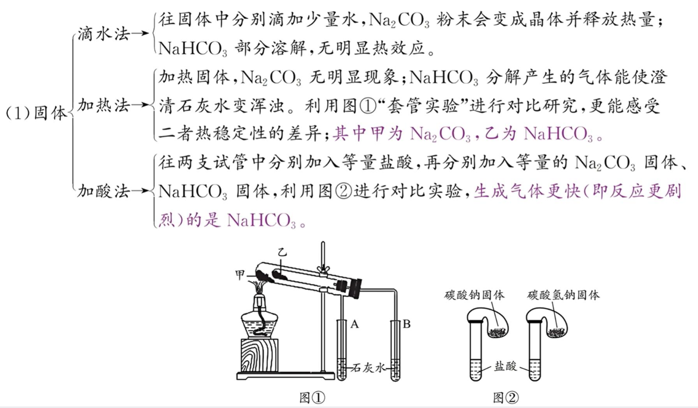
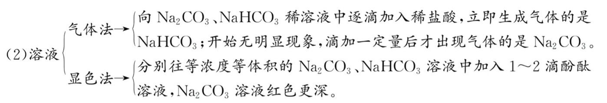

## [2-2]碳酸钠+碳酸氢钠

#### 1. $\text{Na}_2\text{C}\text{O}_3$、$\text{Na}\text{H}\text{C}\text{O}_3$的性质和用途

<table>
  <tdead>
    <tr>
      <td>名称</td>
      <td>碳酸钠</td>
      <td>碳酸氢钠</td>
    </tr>
  </tdead>
  <tbody>
    <tr>
      <td>俗名</td>
      <td>纯碱、苏打</td>
      <td>小苏打</td>
    </tr>
    <tr>
      <td>色、态</td>
      <td>白色粉末</td>
      <td>细小的白色晶体</td>
    </tr>
    <tr>
      <td>水溶性</td>
      <td>易溶于水</td>
      <td>可溶于水(略小于纯碱)</td>
    </tr>
    <tr>
      <td>稳定性</td>
      <td>稳定</td>
      <td>受热易分解 $2\text{NaHCO}_3 \xlongequal{\Delta} \text{Na}_2\text{CO}_3 + \text{CO}_2 \uparrow + \text{H}_2\text{O}$</td>
    </tr>
    <tr>
      <td>与 $\text{CO}_2$</td>
      <td colspan="2">向 $\text{Na}_2\text{CO}_3$ 溶液中通入 $\text{CO}_2$：$\text{CO}_3^{2-} + \text{CO}_2 + \text{H}_2\text{O} \rightleftdarpoons 2\text{HCO}_3^-$；向 $\text{NaHCO}_3$ 溶液中通入 $\text{CO}_2$ 则不发生反应。 注：向“饱和”$\text{Na}_2\text{CO}_3$ 溶液中通入 $\text{CO}_2$，会产生白色沉淀 $\text{NaHCO}_3$：$2\text{Na}^+ + \text{CO}_3^{2-} + \text{CO}_2 + \text{H}_2\text{O} \rightleftdarpoons 2\text{NaHCO}_3\downarrow$。 因为 $\text{CO}_2$ 与 $\text{Na}_2\text{CO}_3$ 溶液反应会消耗水，且 $\text{NaHCO}_3$ 的溶解度小于 $\text{Na}_2\text{CO}_3$。</td>
    </tr>
    <tr>
      <td rowspan="2">与酸</td>
      <td>(1)向$\text{Na}_2\text{CO}_3$溶液中逐滴加入稀硫酸：先：$\text{CO}_3^{2-} + \text{H}^+ = \text{HCO}_3^-$；后：$\text{HCO}_3^- + \text{H}^+ = \text{CO}_2\uparrow + \text{H}_2\text{O}$。 (2)向稀硫酸中滴加$\text{Na}_2\text{CO}_3$：$\text{CO}_3^{2-} + 2\text{H}^+ = \text{CO}_2\uparrow + \text{H}_2\text{O}$。</td>
      <td>无论是向$\text{NaHCO}_3$溶液中滴加稀硫酸，还是向稀硫酸中滴加$\text{NaHCO}_3$溶液，离子方程式都是：$\text{HCO}_3^- + \text{H}^+ = \text{CO}_2\uparrow + \text{H}_2\text{O}$。</td>
    </tr>
    <tr>
      <td colspan="2">利用溶液相互滴加顺序不同(即不同反应物相对量的不同)，导致实验现象不同，可用于物质的鉴别，这种方法叫作“互滴法”。因此可以用“互滴法”鉴别$\text{Na}_2\text{CO}_3$溶液和稀硫酸。</td>
    </tr>
    <tr>
      <td>与碱</td>
      <td>与 $\text{Ba(OH)}_2$： $\text{Ba}^{2+} + \text{CO}_3^{2-} = \text{BaCO}_3 \downarrow$</td>
      <td>(1)与 $\text{Ba(OH)}_2$： ①$\text{Ba(OH)}_2$ 少量：$\text{Ba}^{2+} + 2\text{OH}^{-} + 2\text{HCO}_3^{-} = \text{BaCO}_3 \downarrow + \text{CO}_3^{2-} + 2\text{H}_2\text{O}$； ② $\text{Ba(OH)}_2$ 过量：$\text{Ba}^{2+} + \text{OH}^{-} + \text{HCO}_3^{-} = \text{BaCO}_3 \downarrow + \text{H}_2\text{O}$。 注：该反应虽然存在量变引起质变，但现象一样，因此无法用“互滴法”进行相互鉴别。 (2)与 $\text{NaOH}$：$\text{OH}^{-} + \text{HCO}_3^{-} = \text{H}_2\text{O} + \text{CO}_3^{2-}$ 注：$\text{HCO}_3^{-}$既可与 $\text{H}^+$反应，又可与 $\text{OH}^-$反应，故多元弱酸的酸式酸根离子既不能与 $\text{H}^+$大量共存，也不能与 $\text{OH}^-$大量共存。</td>
    </tr>
    <tr>
      <td>与盐</td>
      <td>与可溶性钙盐或钡盐： $\text{CO}_3^{2-} + \text{Ca}^{2+} = \text{CaCO}_3 \downarrow$ $\text{CO}_3^{2-} + \text{Ba}^{2+} = \text{BaCO}_3 \downarrow$</td>
      <td>高一阶段暂不考虑可溶性钡盐或钙盐与 $\text{HCO}_3^{-}$ 的反应</td>
    </tr>
    <tr>
      <td>主要用途</td>
      <td>用于制玻璃、制肥皂、合成洗涤剂、造纸、纺织、石油、冶金等</td>
      <td>灭火器、治疗胃酸过多、发酵粉的主要成分</td>
    </tr>
  </tbody>
</table>

注：小苏打的“小”有四层含义，分别为①式量（即相对原子质量之和）：小苏打<苏打；②溶解度：小苏打<苏打；③热稳定性：小苏打<苏打；④等浓度溶液的碱性：小苏打<苏打。

#### 2.$\text{Na}_2\text{C}\text{O}_3$、$\text{Na}\text{H}\text{C}\text{O}_3$的相互转化
\[
\mathrm{Na_2CO_3}
\begin{array}{c}
\xrightarrow{\quad \text{(1)向溶液中通入过量 }\mathrm{CO_2}\text{;(2)向溶液中滴加少量盐酸} \quad} \\
\xleftarrow[\quad \text{(1)若为固体,受热分解;(2)若为溶液,向溶液中滴加适量 NaOH 溶液} \quad]{}
\end{array}
\mathrm{NaHCO_3}
\]

注:
①$\text{Na}_2\text{C}\text{O}_3$转化为$\text{Na}\text{H}\text{C}\text{O}_3$，组成上多了H原子，且$\text{Na}\text{H}\text{C}\text{O}_3$碱性弱于$\text{Na}_2\text{C}\text{O}_3$，则说明与$\text{Na}_2\text{C}\text{O}_3$反应的物质是酸性物质；为了不引入新杂质，最佳转化方法是通入过量$\text{C}\text{O}_2$发生反应：
$Na_2CO_3 + CO_2 + H_2O = 2NaHCO_3$

②$\text{Na}\text{H}\text{C}\text{O}_3$溶液转化为$\text{Na}_2\text{C}\text{O}_3$溶液，组成上少了H原子，且$\text{Na}_2\text{C}\text{O}_3$碱性强于$\text{Na}\text{H}\text{C}\text{O}_3$，则说明与$\text{Na}\text{H}\text{C}\text{O}_3$反应的物质是碱性物质；为了不引入新杂质，最佳转化方法是加入适量$\text{Na}\text{O}\text{H}$发生反应：
$NaHCO_3 + NaOH = Na_2CO_3 + H_2O$

#### 3.$\text{Na}_2\text{C}\text{O}_3$、$\text{Na}\text{H}\text{C}\text{O}_3$的鉴别

#### 4.侯氏制碱法
(1)往$\text{Na}\text{Cl}$饱和溶液中先通入$\text{N}\text{H}_3$，形成氨的饱和溶液，再通入过量$\text{C}\text{O}_2$，制备$\text{Na}\text{H}\text{C}\text{O}_3$。
化学方程式：$NH_3 + CO_2 + NaCl + H_2O = NH_4Cl + NaHCO_3 \downarrow$；
离子方程式：$NH_3 + CO_2 + Na^+ + H_2O = NH_4^+ + NaHCO_3 \downarrow$。
注：①$\text{C}\text{O}_2$在水中溶解度较小，为了促进其溶解，一定要先通入极易溶于水的碱性气体$\text{N}\text{H}_3$。
②该反应生成很多$\text{Na}\text{H}\text{C}\text{O}_3$，大部分会以固体形式析出，写离子方程式时$\text{Na}\text{H}\text{C}\text{O}_3$不能拆。
(2)加热$\text{Na}\text{H}\text{C}\text{O}_3$固体: $2NaHCO_3 \overset{\Delta}{=} Na_2CO_3 + CO_2 \uparrow + H_2O$

#### 5.焰色试验

##### (1)定义
某些金属及其化合物在灼烧时火焰呈现特殊的颜色，该物理过程称为焰色试验。

##### (2)操作
洗(用盐酸洗铂丝或铁丝)、烧(灼烧至无色)、蘸(蘸取少量待测液)、烧(灼烧，观察焰色)。

##### (3)常见金属元素的焰色(可按照红、黄、绿、紫顺序记忆):

<table>
 <tdead>
 <tr>
 <td>金属元素</td>
 <td>锂</td>
 <td>锶</td>
 <td>钙</td>
 <td>钠</td>
 <td>钡</td>
 <td>铜</td>
 <td>钾</td>
 <td>铷</td>
 </tr>
 </tdead>
 <tbody>
 <tr>
 <td>焰色</td>
 <td>紫红色</td>
 <td>洋红色</td>
 <td>砖红色</td>
 <td>黄色</td>
 <td>黄绿色</td>
 <td>绿色</td>
 <td>紫色</td>
 <td>紫色</td>
 </tr>
 </tbody>
</table>

注:
①并非所有金属都有焰色，选择光洁无锈的铁丝或铂丝做载体，是因为二者无可见光的焰色。
②用盐酸洗涤是利于杂质被气化除去。
③观察钾元素的焰色时，一般需要用蓝色钴玻璃滤光。